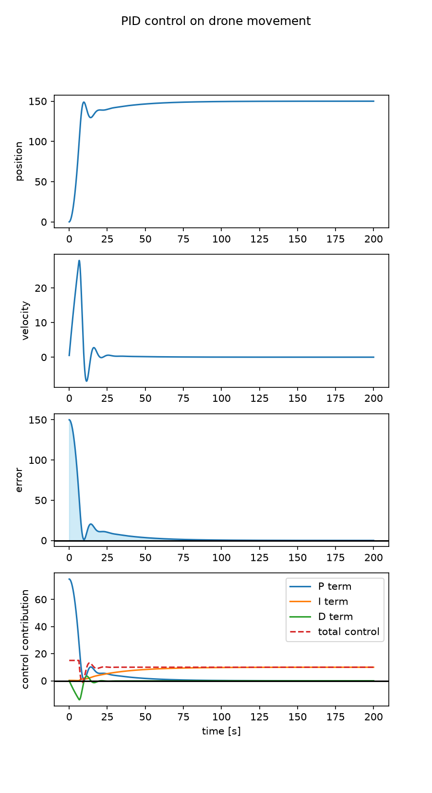
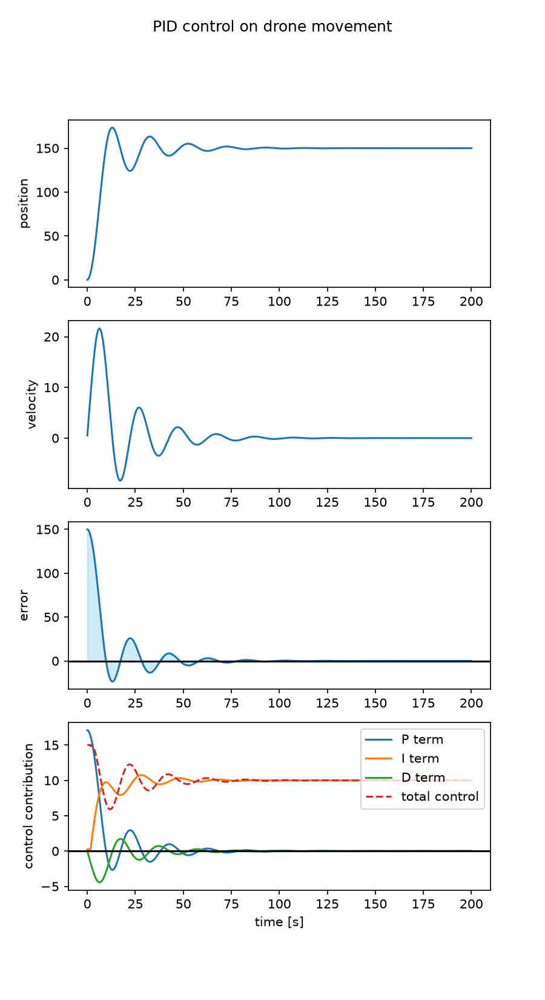

# PID Controller Simulation

A modular PID control simulation in Python. The controller is tested on two simple physical plants (a 1-D car and a drone moving along its vertical axis) with actuator saturation, anti-windup, sensor noise, derivative-on-measurement, and automated Ziegler–Nichols tuning. Responses are evaluated with standard step-response metrics.

Below is the comparison of controller performance on 1-D drone dynamics between manually tuned PID gains and those tuned using the Ziegler-Nichols method

<table>
  <tr>
    <td align="center"><b>Manual tuning</b></td>
    <td align="center"><b>Ziegler–Nichols tuning</b></td>
  </tr>
  <tr>
    <td></td>
    <td></td>
  </tr>
</table>

Each plot shows position, velocity, error, and the P / I / D / total control contributions over time.

## Features

- **PID controller** with derivative-on-measurement and conditional-integration anti-windup
- **Two plants:** a 1-D car (mass + viscous friction) and a drone along its vertical axis (gravity, thrust limit, ground contact)
- **Actuator saturation** and **Gaussian sensor noise** (configurable)
- **Automated Ziegler–Nichols tuning:** finds the ultimate gain and oscillation period by simulation, then computes PID gains
- **Performance report:** rise time, overshoot, settling time, steady-state error, peak control effort, rms control effort, saturation %
- **Diagnostic plots** of the state, error, and each PID term

## Project structure

| File | Description |
|------|-------------|
| `pid.py` | `PID` class: control law, anti-windup, history of P/I/D terms and error |
| `plant.py` | `Plant_Car` and `Plant_Drone` models |
| `simulator.py` | `Simulator`: closed-loop simulation, plotting, and performance metrics |
| `ZieglerNichols.py` | Contains methods `find_ultimate_gain()` and `ziegler_nichols_pid(Ku, Tu)` which automate the Ziegler-Nichols tuning method|
| `main.py` | Demo script: compares manual tuning against Ziegler–Nichols on the drone |
| `results/` | Generated plots and the printed performance report |

## How it works

### Control law

With error `e = r − y` (setpoint minus measured output):

$$u(t) = K_p\, e(t) + K_i \int_0^t e(\tau)\, d\tau - K_d \frac{dy}{dt}$$

- **Derivative on measurement.** The D term differentiates the measured output rather than the error, so a change in setpoint does not cause a derivative spike. The first call initializes the previous output to avoid a startup spike.
- **Anti-windup (conditional integration).** When the command would exceed the actuator limits and the error would push it further into saturation, the integrator is frozen. The plant clips the command to its actuator limits.

### Plants

State is `[position, velocity]`, integrated with a fixed time step (semi-implicit Euler).

- **Car:** `m·a = u − b·v`
- **Drone (vertical axis):** `m·a = u − b·v − m·g` with `g = 10`, a thrust limit, and a ground at `y = 0`

### Ziegler–Nichols tuning

The closed-loop method, automated in simulation:

1. Set `Ki = Kd = 0` and increase `Kp` in small steps.
2. Stop when the response shows sustained oscillation (the last four peak amplitudes agree within a tolerance). That `Kp` is the ultimate gain `Ku`, and the peak spacing gives the period `Tu`.
3. Compute the gains: `Kp = 0.6·Ku`, `Ki = 1.2·Ku / Tu`, `Kd = 0.075·Ku·Tu`.

## Quick start

Requires Python 3.9 or newer.

```bash
git clone https://github.com/johnjooyoungkim/pid-controller.git
cd pid-controller
pip install -r requirements.txt
python main.py
```

Plots are saved to `results/` and the performance report is printed to the terminal.

To change the experiment, edit the parameters at the top of `main.py`: setpoint (`cmd`), time step (`dt`), number of steps (`n`), actuator limits (`u_min`, `u_max`), sensor noise (`noise_std`), and the PID gains.

## Results

Experiment: drone plant (mass 1, friction 0.05), setpoint 150, `dt = 0.1 s`, 200 s simulation, thrust limited to ±15, no sensor noise.

| Tuning | Kp | Ki | Kd | Rise time | Overshoot | Settling time (2%) | Steady-state error | Peak control | RMS control | Saturation (%) |
|--------|------|--------|-------|-----------|-----------|--------------------|--------------------|--------------|-------------|----------------|
| Manual | 0.50 | 0.02 | 0.50 | 5.6 s | 0.0 % | 53.4 s | 0.007 | 15.0 | 10.15 | 3.2 % |
| Ziegler–Nichols | 0.114 | 0.0158 | 0.205 | 6.3 s | 15.6 % | 63.5 s | −0.001 | 15.0 | 10.10 | 0.85 % |

Ziegler–Nichols found `Ku = 0.19` and `Tu = 14.4 s`.

Metric definitions: 
- Rise time:  10% → 90% time
- Settling time: Last time the response leaves a ±2% band around the setpoint
- Steady-state error: Average error over the last 5s
- Peak control: Maximum absolute control signal applied
- RMS control: Root-mean-square value of the control signal (actuator energy)
- Saturation %: Percentage of time steps the control signal saturates

**Observations**

- The performance plot and metrics show that manually tuned gains lead to faster rise and settling time than ZieglerNichols tuning. However, the tradeoff is evident in the massive amount of saturation for the manually tuned controller, whereas Ziegler-Nichols show a much smoother dynamic and lower saturation. 
- If saturation was not present, Ziegler-Nichols tuning would have had much lower controller effort metrics than manual tuning. Saturation conceals the huge spike in controller effort for manual tuning, while also handicapping metrics such as rise-time.

## Limitations and next steps

- This modular design is limited to single-axis plants only; no coupled or multi-axis dynamics.
- No low-pass filter on the derivative term, so the D term amplifies sensor noise
- Fixed-step Euler integration and step-response metrics only 
- Next steps: LQR control, Complex Cart-Pole plant, limited sensor data and full-state estimation using a Kalman Filter in https://github.com/johnjooyoungkim/lqr-control-sim

## Author

Jooyoung Kim, Electrical Engineering at Georgia Tech.
Individual project 
